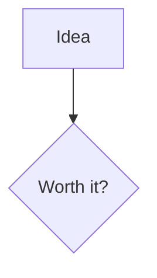

# NoteFlow — Formato de nota y cifrado

## Formato de archivos de nota (v2 — carpeta por nota)

Cada nota es un **directorio** `<slug>-<id>/` (nombre congelado al crear; cambiar el título NO
renombra la carpeta). Dentro: `note.md` (**solo frontmatter**: metadatos + índice de secciones)
y **un `.md` por sección** (`<sectionId>.md`, markdown puro sin frontmatter — editable con
cualquier editor externo, diffs de git limpios). Fuente de verdad: `src/lib/noteUtils.ts`
(`parseNoteFolder` / `serializeNoteFolder` / `buildNoteWritePayload`), **espejado** en
`electron/noteFormat.ts` para main/worker y en `cli/noteflow.js` — mantener los tres en sync.

```
mi-nota-abc12345/
  note.md       ← ancla de metadatos (frontmatter only)
  sec001.md     ← cuerpo de la sección "Note"
  sec002.md     ← cuerpo de la sección "Tasks"
```

`note.md`:
```markdown
---
id: abc12345
title: "Mi nota"
tags: [javascript, react]
created: 2026-01-01T00:00:00.000Z
updated: 2026-01-02T00:00:00.000Z   # timestamp CANÓNICO de conflicto para TODA la nota
formatVersion: 2
group: grp001        # opcional — id de NoteGroup
folder: fld001       # opcional — id de NoteFolder (requiere group)
expiresAt: 2026-01-03T00:00:00.000Z   # opcional — nota temporal (autoborrado)
sections:
  - id: sec001
    name: Note
    file: sec001.md
    isRawMode: true   # true = modo texto (la app lo muestra tal cual, sin renderizar); false/ausente = modo markdown (renderizado). El .md guarda markdown en ambos
    aiHidden: true    # opcional — la IA NUNCA ve esta sección (índice, chat RAG, tools)
  - id: sec002
    name: Tasks
    file: sec002.md
    created: "2026-01-05T10:00:00.000Z"   # opcional — creación de ESTA sección (ver abajo)
    updated: "2026-01-06T09:30:00.000Z"   # opcional — última edición (contenido/nombre) de ESTA sección (ver abajo)
archived: true    # solo presente si true
favorited: true   # solo presente si true
localOnly: true   # solo presente si true — la nota NUNCA se sincroniza (hoy solo la de bienvenida)
---
```

Notas **cifradas**: la carpeta contiene **solo `note.md`** (sin secciones en claro); el
frontmatter lleva el bloque `encryption` de siempre:
```yaml
encryption:
  alg: aes-256-gcm+pbkdf2
  salt: <base64url>
  iv: <base64url>
  ciphertext: <base64url>
  iterations: 310000   # omitido si es el default
  hashAlg: SHA-256     # omitido si es el default
```

- **Nombre de carpeta** (`noteDirname(id, title)` → `<slug>-<id>`, o solo `<id>` si el slug queda
  vacío). Slug: título en minúsculas → **transliteración de acentos** (`normalize('NFD')` y fuera las
  marcas diacríticas U+0300–U+036F: `Reunión 12 nov` → `reunion-12-nov`, `Cumpleaños` → `cumpleanos`)
  → fuera todo lo que no sea `[a-z0-9\s-]` → trim → espacios a `-` → primeros 40 caracteres. Las letras
  sin descomposición (`ß`, `ø`…) se siguen descartando. **Tres espejos con la misma regla**
  (`src/lib/noteUtils.ts`, `electron/noteFormat.ts`, `cli/noteflow.js`; paridad en
  `tests/cli/commandSurface.test.ts`); la tool `create_note` del agente llama a
  `noteFormat.noteDirname` (antes tenía una copia). Hasta 2026-11-17 (CLI < 2.15.0) las letras
  acentuadas se **descartaban** (`reunin-12-nov`, `cumpleaos`): esas carpetas se quedan como están —
  el slug se congela al crear, no hay renombrado ni migración, y nada depende de que el slug coincida
  con el título (la identidad es el `id`).
- **Escalares YAML en el CLI:** el CLI no usa js-yaml; escribe título, nombres de sección y tags
  entre comillas dobles (`q()`) y los lee con `unquote()`, inversos exactos entre sí y compatibles con
  js-yaml en ambos sentidos para escalares de una línea (un título con salto de línea, que la app
  escribe como bloque `|-`, el CLI sigue sin leerlo bien: limitación anterior) (detalle y escapes soportados en `patterns.md` § CLI "Lector/escritor de
  escalares YAML"). Un título con `"` o `\` es válido en los tres clientes.
- Marcador de versión: `<notesDir>/.noteflow-format` (contenido `2`).
- En memoria el `Note` sigue hidratado (`sections[].content`); `Note.filePath` = **directorio**;
  `Note.raw` = contenido de `note.md`. La UI (editor, sidebar, stickies) no cambió.
- Título por defecto: `DD/MM/YYYY`. Sección por defecto: en modo markdown (`defaultSections()`, sin `isRawMode`); una nota nueva creada desde la app (`createEmptyNote`) la nombra en el idioma de la interfaz (`Note` / `Nota`, `common.defaultSectionName` vía `src/i18n/sectionNames.ts`), mientras que las lecturas de notas antiguas (`parseNoteFolder`/`parseLegacyNote`), el CLI, la tool `create_note` de la IA y la importación de .txt/.md desde main siguen usando `Note` — **no des por hecho que la primera sección se llama `Note`**; el CLI también crea las suyas en modo markdown desde v2.5.0 (antes, modo texto) y `--raw` las pone en modo texto (`isRawMode: true`); la `Note` de una nota v1 solo-cuerpo sale en modo markdown tanto en el migrador del escritorio (`parseLegacyNoteRaw`) como en `noteflow migrate`.
- **`created` por sección** (opcional, ISO 8601, misma clave en desktop, CLI y móvil): se escribe
  solo si existe y se conserva en el round-trip (también dentro del payload cifrado, que es el JSON
  del array `sections`). Se asigna `now` al **crear** una sección (nueva pestaña, duplicar — la
  copia es nueva —, `section add`/`set`/`add` del CLI, tools `create_note`/`add_section` del
  agente); las secciones iniciales de una nota nueva (nota vacía, plantilla, duplicar nota, perfil
  IA, import) llevan el mismo timestamp que `note.created`. Excepción: al **regenerar** el perfil
  de IA sobre una nota ya existente (`ProfileFlow.tsx`, "Start over" → `updateNote` in situ), las
  secciones nuevas llevan la hora de la regeneración, no `note.created` de la nota reutilizada.
  Las **plantillas** (`templates.json`) no guardan el `created` de las secciones
  (`templatesStore.createTemplate` lo descarta). **Nunca se rellena** al parsear notas
  antiguas ni en la migración v1→v2, y no se reescriben ficheros para backfill: la UI hace el
  fallback al mostrar con `firstValidDate(section.created, note.created)` (`src/lib/dateUtils.ts`;
  un valor no parseable —p. ej. editado a mano— también cae a `note.created`, y si ninguno es
  válido no se muestra la fecha) — solo en la línea `Created …` bajo el título del editor (ninguna
  tarjeta de preview —vista de nota, hover, cerebro— muestra la fecha de la sección).
- **`updated` por sección** (opcional, ISO 8601, misma clave en desktop, CLI y móvil; va en la
  entrada del índice junto a `created`): hora del **último cambio de contenido o nombre de ESA
  sección**. Se escribe solo si existe y se conserva en el round-trip de los tres espejos (también
  dentro del payload cifrado, que es el JSON del array `sections`). **`note.updated` sigue siendo el
  timestamp canónico** de conflictos/sync; el de sección es solo informativo. Reglas:
  - **Se estampa (`now`)** cuando cambia `content` o `name` de esa sección y solo de esa; las demás
    conservan el suyo. **No** lo mueven `isRawMode` (decidido: cambiar el modo de vista no es editar;
    si al volver al editor éste reescribe un markdown distinto, eso sí es un cambio de contenido y lo
    estampa), `aiHidden`, el orden ni un re-guardado idéntico (el editor puede emitir el mismo
    markdown al montar).
  - **Al nacer**, `updated` = su `created` (mismo valor): nueva pestaña/sección, duplicar sección o
    nota (la copia es nueva: **no hereda** el `updated` del original), secciones iniciales de una nota
    nueva (= `note.created`), perfil IA, tools `create_note`/`add_section`, `section add`/`add`/`set
    --create`/`new` del CLI, nota de bienvenida, import de un `.txt`/`.md`. En el import de otras apps
    (Notion/Keep/carpeta md) la sección lleva `created` = el de la nota externa y `updated` = la hora
    del import (= `note.updated`).
  - **Escritores:** renderer — un único embudo, `applyNoteUpdate` de `notesStore` (por ahí pasan
    `updateNote({sections})`, `mutateSections`, `updateSection`, `duplicateSection`), que llama a
    `stampSectionEdits(prev, next, now)` (`src/lib/sectionUtils.ts`, pura: compara por id con la
    versión anterior; una sección nueva sin sello toma su `created`; una restaurada sin ninguno —deshacer
    el borrado de una sección antigua— queda sin sello). Las **notas vinculadas** no lo llevan (su
    metadato vive en `linked-notes.json`; la UI cae a `note.updated`, que es el mtime del fichero).
    Agente IA — `withSectionEdit` en `electron/ai/llm/tools.ts` (`update_section`/`rename_section`, solo
    si el valor cambia); el **deshacer del chat** restaura la sección entera de `before`, con su
    `updated` anterior, y el sello no cuenta como cambio en `noteFingerprint`/`sectionKey` (igual que
    `note.updated`). CLI — `editSection` (`set`, `add`, `section rename`, `history --restore`) y `touch`,
    que estampa con su **mtime** las secciones cuyo `.md` es más reciente que el `note.md` en más de 2 s
    (`sectionsEditedOutside`: editadas a mano tras `noteflow path`; todo escritor de NoteFlow guarda
    ambos a la vez). Una edición externa **sin** `touch` (el watcher del escritorio la recarga) no lo
    estampa.
  - **Plantillas** (`templates.json`) no guardan `updated` (`templatesStore.createTemplate` lo descarta,
    como `created`).
  - **Nunca se rellena** ni se reescriben ficheros por migración. La UI cae con
    `sectionEditedDate(section, note)` (`src/lib/dateUtils.ts` = `firstValidDate(section.updated,
    note.updated)`; un valor no parseable cae a `note.updated`). Hoy solo lo muestra la meta `Section n
    of m · … · edited …` de la vista previa de la vista de contenido (`SectionPreviewPane`).
  - **Sync:** el ancla se compara **sin sus sellos `updated:`** — el de primer nivel y los de sección
    (líneas `    updated:` con 4 espacios; `anchorWithoutUpdated` → `hashForBase`/`planConflictCopy`, con
    espejo en el CLI). Sin esto, editar secciones distintas en dos dispositivos haría que el `note.md`
    cambiara en los dos lados y `mergeAnchors` tomaría los metadatos de sección del remoto (p. ej.
    perdería un renombrado local). Consecuencia aceptada: cuando gana un lado del ancla, los sellos de
    sección son los de ese lado — tras ediciones concurrentes de secciones distintas, el sello de la
    sección editada en el otro lado puede quedar antiguo (solo afecta a la hora mostrada; el contenido
    se fusiona por fichero como siempre). Las bases de anclas que ya llevaban sellos, grabadas por una
    versión anterior (que los hasheaba), cambian de hash una vez al actualizar: como mucho una
    re-subida/fusión del `note.md` sin pérdida.
  - **Móvil (pendiente, 2026-11-18):** su serializador escribe una lista fija de claves, así que al
    reescribir un `note.md` **pierde** los sellos de sección (la UI del escritorio cae a `note.updated`:
    seguro) y sus ediciones no estampan. Además su espejo de `anchorWithoutUpdated` aún no quita los
    sellos de sección: en el móvil, una edición de contenido hecha en el escritorio cuenta como cambio
    de metadatos del ancla (más fusiones "los dos cambiaron", donde gana la metadata remota) hasta que
    se porte.
- **`localOnly: true`** (clave de primer nivel de `note.md`, también en notas cifradas: va fuera del
  bloque `encryption`): la nota no sale nunca de este dispositivo — ningún camino de sync de GitHub, Cloud
  ni el CLI la sube, la journala ni la borra en remoto (detalle en `sync.md` "Notas solo-locales"). Hoy
  solo la lleva la **nota de bienvenida** de la primera ejecución (`electron/welcomeNote.ts`); no hay UI
  para ponerla ni quitarla. Los **tres espejos** la conservan en el round-trip (`parseMetaFields`/
  `serializeNoteFolder` de `noteUtils.ts`, `parseDiskMeta`/`serializeNoteFolder` de `noteFormat.ts`,
  `parseNoteYaml`/`serializeNoteMd` del CLI): si uno la perdiera al guardar, la nota empezaría a
  sincronizarse. *Duplicate* crea una nota normal (construye el borrador campo a campo); exportar la
  conserva (bundle tal cual), así que una nota solo-local importada en otro equipo sigue siendo solo-local.
- **`expiresAt`** (clave de primer nivel, ISO 8601; nota temporal): la escribe solo la app, después de
  `folder` y antes de `localOnly`. Los **tres espejos** la conservan en el round-trip; el CLI no tiene
  comando para ponerla ni quitarla, pero `serializeNoteMd` la reescribe tal cual (entre comillas, como
  `created`). Hasta 2026-11-17 el CLI la **perdía** en cualquier escritura (`add`, `set`, `touch`,
  `rename`, `section …`, `favorite`, `archive`, `move`, `group`/`folder delete`) y la nota temporal pasaba
  a ser permanente; las notas que ya la perdieron no se recuperan. **Regla al añadir una clave a
  `note.md`:** el CLI reescribe el fichero entero desde lo que su lector guardó y **no conserva claves
  desconocidas** (la app tampoco: `serializeNoteFolder` escribe una lista fija), así que toda clave nueva
  hay que añadirla también a `serializeNoteMd`; `tests/cli/frontmatterPreservation.test.ts` escribe una
  nota con todas las claves opcionales usando el serializador de la app, le pasa los comandos de
  escritura del CLI y compara con el parser de la app — añade ahí la clave nueva.
- **`pinned`** (nombre antiguo de `favorited`): los tres espejos lo leen como `favorited ?? pinned` y
  escriben solo `favorited`. El CLI lo perdía al reescribir una nota que aún lo llevara (dejaba de ser
  favorita); corregido a la vez que `expiresAt`.
- **Notas vinculadas** (un archivo de texto externo —Markdown o texto plano— editado en su sitio): **no usan
  este formato** ni viven en el dir de notas. El archivo es del usuario tal cual (el frontmatter de un `.md`,
  si lo tiene, se preserva y no es de NoteFlow); los metadatos de la nota van en `userData/linked-notes.json`. Ver `patterns.md` § "Notas
  vinculadas".
- Tags se extraen del contenido con `#nombre` (`extractTags`).
- `NOTEFLOW_NOTES_DIR` (env) redirige el dir de notas en app y CLI (testing/scripting).
- Los parsers toleran BOM UTF-8 (editores externos como Notepad lo añaden).

### Cuerpo de sección: escapes inline (`\*`)
El editor escribe con barra invertida el texto que, guardado tal cual, se releería como sintaxis
(`a*b c*d` → `a\*b c\*d`, `__init__` → `\_\_init\_\_`, `++x++` → `\++x++`), y solo eso. Al leer, `\` ante
`` ` * _ ~ [ ] ! + = `` es un escape; ante cualquier otro carácter es texto (rutas de Windows). No toca
el frontmatter ni los tres espejos: el **CLI** lee y escribe el cuerpo en crudo (verá `\*` en lo que
imprime y lo conserva al editar líneas); la **app móvil** aún no los entiende: los muestra con la barra
y, al revés, una `\` tecleada en el móvil ante un carácter escapable (`C:\_x`) se guarda sin doblar y
el escritorio la pierde si edita esa sección (pendiente portar).
Detalle y reglas exactas en `patterns.md` § "Escapes con barra invertida".

### Tablas: ancho de columna (cuerpo de sección)
El cuerpo de una sección es Markdown (`lib/markdownHtml.ts`, ver `patterns.md` "Editor: tablas"); no
toca el frontmatter ni los tres espejos (`noteUtils`/`noteFormat`/CLI no leen tablas). Las tablas son
pipe-tables GFM y el **ancho de una columna va en su celda de la fila separadora**:
- **Codificación:** nº de **guiones** de la celda (los `:` son la alineación y no cuentan:
  `:------------:` = centrada, 12 guiones). **1 guion = 0,5em** del tamaño de letra de la tabla (≈ un
  carácter medio: "N guiones ≈ N caracteres"; escala igual en editor, sticky, vista previa y tarjeta del
  resumen). `---` = **automático** (se ajusta al contenido, lo de siempre). Con ancho: **10…80 guiones**
  (5em…40em): el mínimo es justo el de una columna automática (`min-width: 5em`), así ninguna columna puesta
  a mano es más estrecha que una automática; 1-9 se leen como automático y se reescriben `---`
  (una celda con 1 o 2 guiones, `|-|--|`, es separador válido como en GFM), más de 80 como 80. El ancho es el de la caja de la celda (border-box, de rejilla a rejilla). Ej.:
  `| Producto | Precio | Notas |` + `| ------------------------ | ----------: | --- |` = 12em, 5em a la
  derecha, automática.
- **Lo que se ve:** la columna mide máx(n guiones, palabra más larga de la cabecera): la cabecera nunca
  se parte dentro de una palabra (las celdas del cuerpo sí, para no ensanchar la columna). El arrastre no
  baja de esa palabra, así que lo guardado es lo que se ve; si luego se renombra la cabecera con una palabra
  más larga, o el ancho se escribió a mano, la columna se ve más ancha que lo guardado (sin cortes) y el
  markdown no cambia hasta que se vuelva a redimensionar.
- **Puertas al leer** (por tabla; si falla una, **toda** la tabla es automática): (1) separador con el
  **espaciado canónico** de NoteFlow `| c1 | c2 | … |` (barras exteriores, un espacio a cada lado de cada
  celda; se toleran espacios finales; vale para una columna) — lo compacto de una IA (`|------|`), lo
  indentado o sin barras exteriores no pasa; (2) separador **no alineado con la cabecera**: si sus barras
  sin escapar (`\|` es texto) caen en las mismas posiciones que las de la cabecera, es una tabla de un
  formateador (Prettier, VS Code) o de una IA que alinea → automática.
- **Al escribir** (`tableElToMd`, ancho leído de la celda de cabecera): sin ancho → `---` exactamente como
  antes (`:---:`, `---:`, `:---`); con ancho n → n guiones con sus `:`. Si con anchos el separador quedara
  alineado con la cabecera (puerta 2), se **suma 1 guion a la última columna con ancho** (se resta si está
  en 80): cambio de 0,5em, solo en ese caso, estable desde el primer guardado. Una nota sin anchos se
  guarda byte a byte como antes.
- **Contextos que ignoran siempre los anchos:** markdown pegado como texto (`tableClipboard.ts`,
  `htmlFromMarkdown(…, { columnWidths: false })`), el chat de IA (`ChatView.tsx`, salida de un LLM) y el
  modo `plain` (notas vinculadas y sus vistas previas: ni se leen ni se escriben, el separador sale `---`).
  Una IA que escribe en una nota (tools del agente) o el CLI pasan por las mismas puertas: lo típico
  (alineado o compacto) queda automático. Los **snippets** sí leen anchos (los escribe el usuario: se leen
  como una nota, salvo en una nota vinculada).
- **Consecuencia aceptada:** una tabla escrita a mano con separador espaciado, no alineada y con ≥ 10
  guiones en alguna columna sí toma anchos (es la forma de ponerlos a mano).
- **Móvil:** aún no lo lee ni lo conserva (ver "⚠ Pendiente portar a móvil" en `patterns.md`).

### Bloque de dibujo (cuerpo de sección)
Como el kanban, vive en el Markdown de la sección (`src/lib/drawing/drawingBlock.ts`, integrado en
`lib/markdownHtml.ts`); **no** toca el frontmatter ni los tres espejos. Son dos marcadores de comentario
HTML en columna 0 alrededor de **un único code fence**, cuyo lenguaje dice la variante:

````
<!-- drawing -->

<!-- /drawing -->
````

````
<!-- drawing height="320" -->
```excalidraw
{"type":"excalidraw","version":2,"appState":{"viewBackgroundColor":"transparent"}}
{"id":"a1","type":"rectangle","x":10,"y":20,"width":120,"height":60,"angle":0,"seed":1}
{"id":"a2","type":"text","x":20,"y":30,"width":40,"height":20,"containerId":"a1","text":"Idea"}
{"file":{"id":"f1","mimeType":"image/png","created":1,"dataURL":"data:image/png;base64,…"}}
```
<!-- /drawing -->
````

- **Fuente (`mermaid`):** el texto Mermaid tal cual (lo que escriben la IA y el CLI). Se conserva byte a
  byte, líneas en blanco incluidas — con una salvedad: un fuente que sea **una única línea en blanco** se
  guarda vacío (fence sin contenido).
- **Escena (`excalidraw`):** un objeto JSON **por línea**, para que el diff de git y la fusión por líneas
  del sync (`mergeSectionText`) trabajen por elemento. Serialización **canónica** (`serializeSceneBody`:
  la misma escena da siempre los mismos bytes):
  1. **Cabecera** `{"type":"excalidraw","version":2,"appState":{…}}`. `version` es la del formato: una
     cabecera con `version` **mayor que 2** NO es un dibujo para este build (el bloque se queda como texto,
     intacto) — así un cliente antiguo nunca reescribe un formato futuro. Sin `version` o con una menor,
     se lee. Del `appState` solo se guardan
     `gridModeEnabled`, `gridSize`, `gridStep` y `viewBackgroundColor` (los no nulos; sin ninguno se omite
     `appState`). Nada del estado de sesión (zoom, selección, herramienta…).
  2. **Una línea por elemento** no borrado, en el orden de la escena (orden Z). Claves: `id`, `type`, `x`,
     `y`, `width`, `height` y luego el resto en orden alfabético; objetos anidados con claves ordenadas.
     **Se omiten** `isDeleted`, `version`, `versionNonce` y `updated` (contabilidad de colaboración que
     Excalidraw regenera al cargar con `restoreElements`; así un elemento que vuelve a su sitio da la misma
     línea). `seed` e `index` sí se guardan. `boundElements: null` se escribe `[]` (es lo que Excalidraw
     deja al cargar; si no, la línea cambiaría solo por reabrir).
  3. **Una línea `{"file":{…}}` por imagen** que use algún elemento (`fileId`), ordenadas por id (su
     `dataURL` debe ser una URL `data:`; si no, el bloque es inválido), sin
     `lastRetrieved`. Las imágenes sin usar se descartan.
  - **Redondeo:** los enteros no se tocan; `x`, `y`, `width`, `height`, `points`, `gap` y `fontSize` a
    **2 decimales**; cualquier otro número fraccionario (ángulo en radianes, `focus`/`fixedPoint` de los
    enlaces, `pressures`, `lineHeight`…) a **4**.
- **Atributos del marcador de apertura:** cadena opaca `clave="valor"` conservada en el round-trip (misma
  sintaxis que el kanban: `getKanbanAttr`/`setKanbanAttr`). `height` = alto en px de la vista previa (80…1600;
  sin él, el alto propio del dibujo hasta 360 px, o el que dé su proporción si hay `width`). `width` = ancho
  en px de la tarjeta (160…4000; sin él, el de la columna de lectura; más ancho que la columna, sobresale
  centrada como las imágenes; en pantalla nunca pasa del ancho del editor, sin reescribir el atributo).
  Valores no numéricos o fuera de mínimo se ignoran. Ej.: `<!-- drawing width="900" height="320" -->`. Un marcador cuyos atributos contengan `-->` **no** es un
  marcador de apertura (el comentario HTML acabaría ahí): la región se queda como texto.
- **Longitud del fence:** tres backticks, o uno más que la línea de solo-backticks más larga del contenido
  (un Mermaid con una línea ` ``` ` no rompe el bloque). El fence se cierra en la primera línea formada solo
  por al menos tantos backticks como la de apertura.
- **Tolerado al leer** (y normalizado al guardar): líneas en blanco entre marcador y fence y entre líneas de
  la escena, CRLF, claves en cualquier orden, decimales de más, y un **documento Excalidraw entero** pegado
  en el fence (`{"type":"excalidraw","elements":[…],"files":{…}}`, en una o varias líneas).
- **Validez — si falla algo, NO es un dibujo** (`parseDrawingMarkdown` → `null`) y la región se pinta y se
  guarda exactamente como antes de existir el bloque (dos comentarios como texto y un bloque de código
  normal), sin reescribir nada: falta un marcador o el fence, hay texto entre marcador y fence, el lenguaje
  no es `mermaid`/`excalidraw`, marcador o fence indentados, atributos con `-->`; en una escena, cualquier
  línea que no sea un objeto JSON, sin cabecera, con otro `type` o con `version` > 2, elemento sin
  `id`/`type`, `id` repetido, línea desconocida;
  en una fuente, una línea de marca de conflicto de sync (`> ⚠…`). **Es la red de seguridad ante conflictos
  de sync:** el bloque de conflicto cae dentro del fence, el dibujo pasa a ser texto con las dos versiones
  visibles, y al resolverlo a mano (también en modo texto) vuelve a ser un dibujo.
- **Dónde se lee:** solo en el nivel superior de la sección. No dentro de una cita ni de un bloque de
  código — incluido el bloque de un fence **sin cerrar**, que se pinta como código hasta su final: un dibujo
  pegado debajo (sin línea en blanco) sigue siendo código, como siempre —, ni en modo `plain` (notas vinculadas: se queda como texto y código). Sí en markdown pegado y en
  el chat de IA (`columnWidths: false`), igual que el kanban.
- **Fusión por líneas (límites conocidos, cubiertos por tests):** ediciones de elementos distintos y no
  contiguos fusionan limpio; elementos añadidos al final en los dos lados se conservan (los del remoto
  primero); el mismo elemento editado en los dos lados, o **dos elementos contiguos** editados cada uno en
  un lado, dan conflicto → texto. ⚠️ **Dos dispositivos que crean un dibujo en el mismo punto** de la
  sección (donde la base no tenía nada) se fusionan en **un solo bloque** con los elementos de ambos, sin
  aviso: marcadores, fence y cabecera son líneas idénticas en los dos lados y la fusión las toma una vez.
  No se pierde ningún elemento, pero los dos dibujos quedan superpuestos en el mismo lienzo.
- **Cargar y guardar (editor):** una escena se carga SIEMPRE por el `restore` de Excalidraw
  (`lib/drawing/drawingScene.ts` → `restoreScene`), nunca con los elementos crudos; `refreshDimensions` solo
  si algún texto viene sin tamaño (escrito a mano: Excalidraw lo descartaría por invisible) — nunca para una
  escena que escribió Excalidraw, porque re-mediría el texto con las métricas de cada plataforma. El editor
  solo reescribe el bloque si el usuario cambió la escena (ver `patterns.md` § «Bloque de dibujo»): abrir y
  cerrar no canoniza un bloque escrito a mano.
- **Texto legible:** `drawingText(block)` (fuente → el Mermaid; escena → etiquetas y conexiones «A → B»).
  De él salen el texto de respaldo del bloque, la búsqueda (en nota y global), el recuento de palabras y
  lo que ve la IA (`[drawing #n: …]`); los tags ignoran los dibujos enteros. Ver `patterns.md` § «Bloque
  de dibujo» → «El dibujo como texto» y `ai.md` § «Dibujos y la IA».
- **CLI:** no conoce el formato (lee y escribe el markdown tal cual); su skill explica cómo añadir un
  diagrama Mermaid y que un bloque `excalidraw` no se edita a mano.
- **Móvil:** aún no lo conoce. Su conversor (espejo antiguo de `markdownHtml.ts`) lo lee como párrafo +
  bloque de código + párrafo y, al guardar la sección, lo reescribe con una línea en blanco entre
  marcador y fence (el escritorio lo tolera y lo normaliza); un fence de 4+ backticks no lo conserva.

### Tareas para agentes: marcador 🤖 y fichero reservado `agent.md`

Una tarea de checklist (`- [ ] …`) se puede encargar a un agente de IA externo (Claude Code, Codex… en
cualquier máquina con el CLI y sync). **Fase 1 (CLI v2.17.0, 2026-11-20):** el CLI (`noteflow task …`,
sección "Agent tasks" de `cli/noteflow.js`; comandos y decisiones en `patterns.md` § CLI "Tareas para
agentes"). **Fase 4a (CLI v2.18.0, 2026-11-20):** `noteflow run`, el envoltorio que lanza un agente sobre
una tanda (`patterns.md` § CLI "`noteflow run`"). **Fase 4b (escritorio + CLI v2.18.1, 2026-11-20):** el botón **Run** de la app, que lanza ese envoltorio en una terminal o abre una app de escritorio (`patterns.md` § "Tareas con agentes: ejecutar"), y la app toma el lock del CLI. **Sync (CLI v2.18.2, 2026-11-21):** dos versiones de la **misma** línea de tarea (mismo id, distinto estado) ya no quedan entre marcas ⚠️ al fusionar: gana el estado más avanzado (`pickAgentTaskLine`; desde CLI v2.23.2 también una línea con marcador frente a la misma sin marcador y misma casilla: decide la base y, si no, gana la marcada; desde CLI v2.24.1 también el texto editado en un lado y el estado en el otro: una línea con el texto nuevo y el estado del otro lado, `settleAgentTaskEdit`), y los comandos `task` resuelven solos una subida rechazada por Cloud — `sync.md` § "La línea de una tarea de agente en la fusión". **Fase 2a (escritorio, 2026-11-20): la base** — la app conserva el marcador, no trata
`agent.md` como sección, lo protege en su sync y expone los IPC. **Fase 2b (escritorio, 2026-11-20): la
interfaz** — chip de estado junto a cada tarea, menú del informe, interruptor en Ajustes → IA y
mantenimiento automático (`patterns.md` § "Tareas con agentes: interfaz"; formato y reglas, en "En la app
de escritorio" abajo). **Fase 3:** copiar el encargo (`patterns.md` § "Tareas con agentes: enviar"). El
móvil aún no lo conoce. Dos piezas, las dos sincronizadas:

- **Marcador en la línea de la tarea** — el estado viaja en la propia línea (cuerpo de sección: no toca el
  frontmatter ni los tres espejos):
  `- [ ] Arreglar X 📅2026-12-01 ⏰09:30 🔺high 🤖k3f9a:running`
  - Forma: ` 🤖<id>:<estado>`, palabra propia, **al final de la primera línea física** de la tarea, después
    de `📅 ⏰ 🔺` (en ese orden). `<id>` = 5 caracteres `[a-z0-9]`, **único entre todas las notas** del dir
    (se comprueba al generarlo contra las líneas y los bloques de todas las notas legibles; las cifradas
    no cuentan).
  - Estados que se escriben: `queued`, `running`, `waiting`, `review`, `done`, `failed`, `interrupted`.
    **`no-signal` no se escribe nunca**: es derivado (`running`/`waiting` cuyo `lastSignal` supera
    `agentTasks.staleMinutes`, por defecto 90). **`interrupted` lo escribe un único sitio:** el cierre de
    `noteflow run` (CLI v2.18.0), para una tarea de su tanda que sigue `running`/`waiting` cuando el agente
    que lanzó ha salido (sin terminal, o si el usuario lo elige al preguntarle) — `patterns.md` § CLI
    "`noteflow run`". Ningún comando `task` lo escribe y la app tampoco; `task start` lo acepta como punto
    de partida. **La app escribe solo dos:** `queued` (apuntar una tarea,
    o devolverla a la cola) y `done` ("Marcar como hecha", o marcar la casilla de una tarea en `review`).
  - **Una sola regex** lo lee: `AGENT_MARKER_RE` (exportada). Se **escribe** al final, pero se **lee** en
    cualquier punto de la línea (otro editor puede añadir sus anotaciones detrás); al reescribirlo vuelve al
    final. Un estado que esta versión no conoce es texto opaco: se lista tal cual y ningún comando lo pisa
    (salvo `task dismiss`, que quita el marcador entero).
  - El texto de la tarea que se enseña (encargo, listados, `title` del bloque) va sin el marcador ni
    `📅 ⏰ 🔺` (`agentTaskText`). Las líneas dentro de un bloque de código, las citadas o
    sin casilla no son tareas sobre las que actúen los comandos (pero su marcador sigue manteniendo vivo el
    bloque: ver "Huérfanos").
  - **Tareas con saltos de línea** (CLI v2.23.3 + los dos espejos de la app): el editor escribe un salto
    dentro de una tarea (hardBreak) como el resto del texto en la línea siguiente, **sin sangría** — una
    continuación «lazy» de Markdown — y al leer mete en el ítem cualquier línea así de su bloque de lista.
    `agentTaskLines` hace lo mismo: las líneas justo debajo de la primera **con cualquier sangría** (CLI
    2.24.2; antes solo las sangradas como mucho igual que ella — dentro de un tablero kanban sigue siendo
    así, abajo) que pueden continuarla (`agentTaskContinues`: no en blanco, no un ítem de lista de ningún tipo
    ni profundidad —ni un marcador vacío—, no una valla de código, no una línea que empieza por `<!--`
    —como los marcadores de kanban/dibujo—) son texto de la tarea: `more` (su texto, como `text`, una entrada
    por línea) y `text` = la tarea **entera en una línea** (primera + continuaciones, unidas con espacio).
    De `text` salen el `title:` del bloque (una línea: la cabecera es una clave por línea), los listados,
    `queue --match` y la re-asociación de un bloque cuyo marcador se perdió (que acepta también un `title`
    de solo la primera línea, el que escribían las versiones anteriores). El encargo de `task start` usa
    `more` para enseñar cada línea en la suya (`patterns.md` § CLI). El marcador sigue **solo en la
    primera línea** (`withAgentMarker`, `setAgentMarkerInContent`, `pickAgentTaskLine` trabajan sobre ella
    y no cambian); un 🤖 en una continuación no lo leen los comandos (sí `agentIdsIn`).
  - Convención: **lo indentado bajo la tarea le pertenece** (`agentTaskChildren`; el encargo lo imprime
    verbatim): sus subítems y lo que cuelga de ellos. Las continuaciones de la propia tarea no se repiten
    como hijas; una continuación de una **subtarea** (salto de línea dentro de ella) sí cuenta como hija
    del padre — antes cortaba la lista de hijas.
  - **Una línea más sangrada que no es ítem es texto de la tarea, no hija** (CLI 2.24.2 + los dos espejos,
    QA yilsf 2026-11-22). `    detalle` bajo `  - [ ] subtarea` (o `  detalle` bajo `- [ ] tarea`) es lo
    que enseña el editor: `parseMdListItems` (`src/lib/markdownHtml.ts`) añade toda línea que no es ítem al
    último ítem abierto, y al guardar la reescribe en columna 0 — coincide con CommonMark (continuación de
    párrafo) y no cambia al editar. Antes estos lectores la tomaban por hija hasta que la app la
    reescribía, y entonces por texto (cambiaba el `title` del bloque). **Excepción: dentro de un tablero
    kanban** (`agentInKanbanBoard`: el marcador de tablero más cercano por encima, en columna 0, es el de
    apertura) solo continúan las líneas sangradas como mucho igual que la tarjeta: una más sangrada es su
    `extra` (`src/lib/kanban.ts`), una hija. Los tres lectores (`cli/noteflow.js` `agentTaskMoreCount`,
    `src/lib/agentTasks.ts`, `electron/agentTasks.ts`) cambian **a la vez** (paridad en
    `tests/electron/agentTasks.test.ts`).
- **`agent.md`** en la carpeta de la nota — nombre **reservado**, **no es una sección**: no figura en el
  índice `sections:` de `note.md` y ningún lector lo trata como tal. Un bloque por tarea:
  ```
  <!-- task:k3f9a -->
  title: Arreglar X
  section: Tasks
  state: done
  createdAt: 2026-11-20T10:00:00.000Z
  …
  ---
  ## Informe
  (markdown libre)
  <!-- /task:k3f9a -->
  ```
  - Cabecera = líneas `clave: valor`, **una por línea** (la fusión línea a línea del sync trabaja por
    clave), siempre en el mismo orden (`AGENT_META_KEYS`): `title`, `section`, `state`, `createdAt`,
    `startedAt`, `finishedAt`, `lastSignal`, `machine` (hostname), `agent` (`--agent` de `task start`, o el
    nombre del agente que lanzó `noteflow run`), `cwd`, `onFinish`
    (`check`|`review`), `batch` (ids de la tanda, separados por coma: lo graba `task start <ids>` con
    varios ids y de él sale el `Next:` de `finish`/`fail`; **`noteflow run --parallel` no lo graba y borra el
    que hubiera** en las tareas del run, para que el `finish` de un subagente nunca mande a otro a por la
    tarea de un tercero), `progress` (una línea, se
    sobrescribe; su porcentaje, `percent`, va aparte: abajo), `question`, `failReason`, `gitBranch`, `gitStartHead`, `gitEndHead`, `gitCommits`,
    `gitFilesChanged`, `orphanedAt`. Timestamps ISO. Las claves vacías no se escriben; las desconocidas se
    conservan (detrás de las conocidas).
  - **`run`** (CLI v2.18.0): el token aleatorio (16 hex) del `noteflow run` que empezó la tarea; solo está
    mientras la tarea sigue `running`/`waiting` dentro de ese run (lo borran `finish`, `fail`, el cierre del
    run y cualquier `start` ajeno). Sirve para que el `task start` que el agente repita dentro de su run
    reimprima el encargo sin tocar el bloque (`patterns.md` § CLI "`task start` dentro de un run").
    **A propósito NO está en `AGENT_META_KEYS`**: así el CLI y la app la escriben en el mismo sitio (detrás
    de las conocidas, como toda clave que la app no conoce) y la fusión por líneas no ve movimiento; el
    lector y el escritor de la app la conservan tal cual (hay test en `tests/cli/agentRun.test.ts`). Si
    algún día se añade a la lista, hay que añadirla **a la vez** en `electron/agentTasks.ts` y
    `src/lib/agentTasks.ts`.
  - **`model`** (CLI v2.20.0, opcional): el modelo con el que `noteflow run --model` lanzó al agente
    (`opus`, `gpt-5-codex`…). Lo graba el claim del run en la primera tarea y el `task start` que se haga
    **dentro** de ese run en las demás (`NOTEFLOW_RUN_MODEL`); cualquier `start` fuera del run lo borra,
    con `agent`. Se conserva tras `finish`/`fail` (la app lo enseña en la cabecera del informe junto al
    agente). Sin `--model` no se escribe: los bloques quedan como antes. **Fuera de `AGENT_META_KEYS`**
    por la misma razón que `run` (versiones anteriores lo conservan detrás de las conocidas, en el mismo
    sitio).
  - **`effort`** (CLI v2.23.0, opcional): el esfuerzo con el que `noteflow run --effort` lanzó a Claude
    Code (`low` | `medium` | `high` | `xhigh` | `max`). Igual que `model`: lo graba el claim del run y el
    `task start` de dentro del run (`NOTEFLOW_RUN_EFFORT`), lo borra cualquier `start` fuera de él, se
    conserva tras cerrar y la app lo enseña con el modelo (`claude (Opus 5.5 · high effort)`; un valor
    que no es un nivel conocido no se enseña). Sin `--effort` no se escribe. Fuera de `AGENT_META_KEYS`.
  - **`percent`** (CLI v2.22.0, opcional): la estimación del agente de cuánto lleva de la tarea entera,
    entero `0`–`100` (se escribe sin `%`). La escribe **solo `task report --percent <n>`** (acepta `40` o
    `40%`; otro valor → exit 1 sin escribir nada); un `report` sin `--percent` la deja como estaba y uno
    con `--percent` y sin texto deja `progress` como estaba. La borra cualquier `task start` que reclame
    (con `progress`; no la reimpresión del `start` dentro de un run); `ask` la conserva y `finish`/`fail`
    también, igual que `progress`. Lectura tolerante e idéntica en los dos lados (`parseAgentPercent`
    del CLI = `agentPercent` de `src/lib/agentTaskUi.ts`, hay test que los compara): entero de 1–3
    cifras con `%` y espacios opcionales, ≤ 100; decimales, signo o basura = sin valor. La app la
    enseña **solo en vivo** (`running`/`waiting` con señal) como barra en la cabecera del informe
    (`patterns.md` § "Tareas con agentes: interfaz"). **Fuera de `AGENT_META_KEYS`**, como `run`/`model`:
    la app (que no la escribe) y versiones anteriores la conservan detrás de las conocidas, en el mismo
    sitio.
  - **`desktopSession`** (CLI v2.21.0, opcional): la sesión de **Claude Desktop** en la que trabaja el
    agente que empezó la tarea, `local_<uuid>` — la `CLAUDE_CODE_HOST_SESSION_ID` que Claude Desktop da al
    Claude Code que lanza y que heredan los procesos de este (o sea, el `noteflow task start` del agente;
    también sus subagentes). Lo graba **`task start`** solo si `CLAUDE_CODE_ENTRYPOINT === 'claude-desktop'`
    y el id cumple `AGENT_DESKTOP_SESSION_RE` = `^local_[A-Za-z0-9-]{1,64}$` (la misma validación que hace
    Claude Desktop con su enlace); cualquier otro `start` la borra (con `agent`/`model`), así que una
    tarea retomada con `--force` desde otra sesión o desde una terminal queda con la suya o sin ninguna.
    **Nunca dentro de un `noteflow run`** (token de run en el entorno): su agente corre en una terminal,
    aunque el envoltorio se lanzara desde una shell de Claude Desktop y heredara sus variables. `report` /
    `ask` no la tocan; se conserva tras `finish`/`fail` (para releer la conversación) y en la reimpresión
    del `start` de un run. La app la usa para *Open in Claude* del informe (`patterns.md` § "Tareas con
    agentes: interfaz"): solo en el equipo de `machine`. **Fuera de `AGENT_META_KEYS`**, como `run` y
    `model`. Es contenido de disco/sync: main la vuelve a validar antes de construir ningún enlace.
  - **Escritura:** el CLI escribe `agent.md` (y la línea de la tarea, y `note.md`) de forma **atómica** y
    bajo un **lock por carpeta de nota** que vive fuera del directorio de notas — contrato en `patterns.md`
    § CLI "Lock entre procesos". La app toma **el mismo lock** y escribe `agent.md` igual de atómico desde
    la fase 4b (`electron/agentLock.ts`).
  - **Una línea `---` separa la cabecera del informe** y se escribe siempre, aunque no haya informe: sin
    ella, las marcas `> ⚠️ Sync conflict…` (que llevan líneas en blanco) de un conflicto dentro de la
    cabecera habrían mandado las claves al informe. Una línea del informe que parezca un delimitador de
    bloque se escapa con `\`.
  - Lectura tolerante (`parseAgentDoc`): CRLF, texto fuera de los bloques (se ignora), bloque sin cerrar
    (acaba en el siguiente), id repetido (gana el primero), líneas de la cabecera que no son `clave: valor`
    (se saltan) y clave repetida (gana la última). El fichero se escribe en LF; **sin bloques se borra**.
  - **La línea manda sobre el bloque:** el `state:` (y `title`/`section`) del bloque es un espejo de la
    línea y se repara en la siguiente escritura de un comando `task` sobre esa nota
    (`reconcileAgentBlocks`); un marcador sin bloque crea el suyo.
  - **Huérfanos:** un bloque cuyo id ya no está en ninguna sección de la nota recibe `orphanedAt` la primera
    vez que lo ve **una escritura del CLI sobre esa nota** (cualquiera: `writeNoteFolder` →
    `maintainAgentFile`, y los comandos `task`) y se borra a los 7 días; si el id reaparece, se quita.
    "Estar en la nota" es **conservador** (`agentIdsIn`): basta con que el texto `🤖<id>:` aparezca en
    cualquier punto de cualquier sección — una línea sin casilla, una cita, dentro de un bloque de código —,
    aunque esa línea ya no se lea como tarea. Borrar un informe exige que el id haya desaparecido de verdad.
  - **Notas cifradas:** fuera, como en todo el CLI.
- **Ajustes** (locales, `settings.json` → `agentTasks`, no se sincronizan; en Windows ese fichero es
  también el del CLI): `enabled` (`false` por defecto: la interfaz de la feature no se enseña — solo lo
  usa la app), `onFinish` (`review` por defecto | `check`; desde 2026-11-23 — antes `check` —: ausente o
  basura se lee `review` y solo un `check` escrito lo cambia; solo se escribe cuando el usuario lo elige, así
  que un fichero viejo que ya tenga `"onFinish": "check"` lo conserva), `staleMinutes` (90) y `discardAfterDays`
  (30; `0` = nunca — solo la app), `commit` (`false` por defecto; solo un `true` explícito lo activa y
  solo se escribe cuando el usuario lo cambia). El CLI lee `onFinish`, `commit` (la regla de commit del
  briefing de `task start` en un repo git — `patterns.md` § CLI "Tareas para agentes") y `staleMinutes`, y además dos claves que usa
  `noteflow run` (CLI v2.18.0) y que la app escribe desde Ajustes → IA → **Run with** (fase 4b): **`agent`** — qué agente lanza: un preset (`claude`,
  `codex`, `gemini`, `opencode`), `custom`, o un comando / plantilla; sin ella, `claude` — y
  **`agentCommand`** — la plantilla del comando cuando `agent` es `custom`, con los marcadores `{prompt}`
  (el prompt, un argumento) y `{promptFile}` (ruta de un fichero temporal con el prompt). `--agent` gana a
  las dos. Solo de la app (fase 4b, `architecture.md`): `launch` (terminal o qué app de escritorio),
  `agentUrl` (plantilla del enlace personalizado), `batchMode` (le llega al CLI como `run --parallel`),
  `models` (el modelo de cada agente; le llega como `run --model`), `efforts` (el esfuerzo de Claude Code; le
  llega como `run --effort`), `folders` (carpeta del proyecto por nota) y `approved`
  (aprobaciones de comandos/enlaces personalizados; estas dos últimas solo las escribe main tras un
  diálogo nativo). La app
  sanea `agent` a un preset o `custom` **al enseñarlo**, pero solo lo reescribe en el fichero si el
  usuario lo cambia: `patchAgentTaskSettings` conserva las claves que no conoce y un `agent` escrito a
  mano. Saneador único:
  `sanitizeAgentTaskSettings` (mismas reglas que `agentTaskSettings` del CLI para las claves comunes).
  En la app se cambian en Ajustes → IA → "Your notes and AI" → **Agent tasks** (`enabled`, `onFinish`, `batchMode`, `commit` y
  `discardAfterDays`, más los de **Run with**; `staleMinutes` no tiene control: se edita en el fichero).
- **Sync en el CLI:** `agent.md` sube y baja como un fichero de sección más (todos los caminos enumeran
  `<dir>/*.md`), con las excepciones que hacen falta por no estar en el índice — detalle y límites en
  `patterns.md` § CLI "Tareas para agentes". **Sync en la app:** `sync.md` § "`agent.md` en el sync".

#### En la app de escritorio (fase 2a: la base; la interfaz, fase 2b, está en `patterns.md`)

Lógica pura en **`electron/agentTasks.ts`** y su espejo **`src/lib/agentTasks.ts`** (`electron/` y `src/`
no se importan entre sí: los dos ficheros son **el mismo texto** bajo la línea `── mirrored below this
line ──`, y `tests/electron/agentTasks.test.ts` falla si difieren o si alguna función deja de dar **lo
mismo que la del CLI** con la misma entrada — `parseAgentDoc`/`serializeAgentDoc` byte a byte,
`parseAgentTaskLine`, `withAgentMarker`, `agentTaskLines` (con sus continuaciones), `agentIdsIn`, `maintainAgentBlocks`,
`agentDisplayState`). Al tocar el formato hay que tocar los **tres** (CLI + los dos espejos).

- **El marcador es un atributo de la tarea, nunca texto.** `extractDeadlineAnnotations`
  (`src/lib/markdownInline.ts`) lo saca de la línea junto a `📅 ⏰ 🔺` (`agentId` + `agentState`: los dos o
  ninguno) y `taskAnnotationsToMd` lo escribe **siempre el último**. Viaja como `data-agent-id` /
  `data-agent-state` en el HTML (`markdownHtml.ts`), como atributos `agentId`/`agentState` del nodo
  `taskItem` (`DeadlineTaskItem.ts`) y como campos opcionales de `KanbanCard` (`kanban.ts`/`kanbanOps.ts`:
  solo existen en la tarjeta que tiene marcador). Reglas:
  - Se **lee en cualquier punto** de la línea y vuelve al final al guardar. En una tarea de varias líneas,
    un marcador en una línea posterior se recupera si la tarea no tiene ninguno (y vuelve a la primera
    línea, donde lo lee el CLI); si ya tiene uno, es texto del usuario y se queda donde está.
  - **Una tarea = un marcador:** el primero es el de la tarea; otro en la misma línea se **descarta** al
    guardar (lo mismo que hace `withAgentMarker` del CLI al reescribir la línea). Es el único caso en que
    el editor quita un marcador por sí solo; solo se da en líneas hechas a mano.
  - Estado desconocido (`[A-Za-z][A-Za-z0-9_-]*`): se conserva tal cual. Fuera de una tarea (viñeta,
    párrafo, lista numerada) o en una nota vinculada en Markdown plano, `🤖…` es texto normal.
  - "Limpiar" fecha/alarma/importancia (los pickers) **no** quita el marcador: solo lo tocan las
    acciones de tareas con agentes (el chip y el menú del informe: `patterns.md` § "Tareas con agentes:
    interfaz").
  - **Un id no se duplica dentro de un documento por editar:** los atributos llevan `keepOnSplit: false`
    (Enter en una tarea marcada → la tarea nueva nace sin marcador; Enter al principio de la línea → el
    marcador **baja con el texto**, igual que la casilla, la fecha, la alarma y la importancia: el
    `Enter` de `DeadlineTaskItem`), y un plugin de `DeadlineTaskItem` quita el marcador de la **copia** en
    un pegar / soltar-copia (`lib/agentTaskNodes.ts` → `dedupeAgentMarkers`: se queda el ítem que ya
    estaba; cortar y pegar es mover y no cambia nada). Solo reacciona a transacciones de pegar/soltar: el
    contenido que llega de disco con un id en dos líneas (una fusión del sync) **no se toca**.
  - **Copias:** duplicar una sección (`duplicateSectionInList`) o una nota (`notesStore.duplicateNote`)
    deja la copia **sin marcadores** (`clearAgentMarkersInContent`) y no copia `agent.md`: las tareas se
    quedan en el original. ⚠️ No cubierto: pegar una tarea marcada en **otra** sección o nota (el id queda
    en dos sitios → el CLI lo detecta y lo dice, ver `patterns.md` "Id repetido"), exportar/importar
    (las secciones viajan con sus marcadores, `agent.md` no) y las plantillas creadas a partir de una nota.
  - **Una tarea que deja de ser tarea pierde el marcador sin avisar** (el atributo vive en el nodo
    `taskItem` y se va con él). Dos caminos: **convertir la lista de tareas** en viñetas o numerada
    (botones de lista de la toolbar, `EditorToolbar.tsx` → `toggleBulletList` / `toggleOrderedList`, y
    volver a pulsar el de tareas) y **unir una tarea marcada con la anterior** (`Backspace` al principio:
    su texto pasa a la tarea de arriba y su marcador se pierde). Es deliberado: conservarlo
    no tiene sentido (una viñeta no es una tarea, y dos tareas fundidas no pueden llevar dos ids) y
    **el bloque no se descarta en ese momento**: `Ctrl+Z` devuelve el marcador y el informe debe seguir
    ahí. Queda huérfano y lo recoge la regla de siempre (`orphanedAt` + 7 días) en el siguiente
    mantenimiento de la app (con la función activada) o escritura del CLI sobre la nota.
- **Nunca se ve ni cuenta como texto** fuera del editor: previews y tarjetas (van por `htmlFromMarkdown`),
  recuento de palabras (`noteOverviewGrid.ts` → `lineWords`), búsqueda (`searchUtils.ts`: «running» no
  encuentra una tarea por su estado), texto de las alarmas/notificaciones (`alarmUtils.ts`), y embeddings,
  FTS y snippets de la IA (`aiWorker.ts` → `stripNoise`). Todos con `stripAgentMarkers`. **Excepciones a
  propósito:** el Modo texto de una sección (enseña el fichero tal cual, como `📅`) y lo que **lee el
  agente del chat** (`get_note`, contexto): ve el marcador para poder reescribir la sección sin perderlo
  (⚠️ un `update_section` del LLM que omita el marcador lo quita, como cualquier edición del texto).
- **`agent.md` no es una sección en ningún lector:** `readNoteDirRecord` (`electron/noteFormat.ts`) no lo
  entrega al renderer y el fallback tolerante de `parseNoteFolder` (`src/lib/noteUtils.ts`) lo excluye
  aunque le llegue. Un guardado de la app no lo toca (solo borra los ficheros de `deleteFiles`); mover la
  nota de grupo o renombrarla no cambia la carpeta (el slug se fija al crearla), y borrar la nota —o
  moverla al archivo local de un cambio de origen— se lo lleva con la carpeta.
- **IPC** (`agent-tasks:*`, contrato en `architecture.md`): leer los bloques, quitar uno (`dismiss`),
  mantenimiento de huérfanos (`maintain`), id nuevo, ajustes, y los eventos `agent-tasks:changed` (el
  fichero cambió en disco; el watcher **no** recarga la nota por un cambio de `agent.md`) y
  `agent-tasks:settings-changed`. **Main nunca toca `note.md` ni una sección** desde ahí: el marcador de
  la línea es del renderer. La lógica de los handlers vive en **`electron/agentTasksFile.ts`** con el
  disco, el sync y las ventanas **inyectados** (`AgentNoteDeps`; `main.ts` pone los reales) y está
  cubierta con una carpeta en memoria (`tests/electron/agentTasksFile.test.ts`): `writeAgentFile` (marca
  la escritura interna **antes** de tocar el disco, sube o borra en el remoto, avisa a las ventanas; no
  hace nada si el disco ya dice eso), `readAgentTasks`, `dismissAgentTask`, `maintainAgentTasks`,
  `reconcileAgentBlock` (el bloque toma el estado de su línea en disco, y `finishedAt` al pasar a
  `done`/`failed`: `agent-tasks:reconcile`, tras un cambio de estado hecho desde la app o al deshacerlo;
  sin bloque, devuelve el que la app descartó si su marcador ha vuelto —un `Ctrl+Z` de *Discard*—),
  `takenAgentIds`, `planAgentSettingsUpdate`, y el predicado `noteMdLooksEncrypted` (clave `encryption:`
  de primer nivel **del frontmatter**, no la palabra en el título ni en el cuerpo).
- **Mantenimiento** (lo dispara el renderer al leer los bloques de una nota abierta, solo con la función
  activada — `agentTasksStore`, ver `patterns.md` § "Tareas con agentes: interfaz"):
  - **Huérfanos:** `agent-tasks:maintain` aplica la misma regla conservadora que el CLI
    (`maintainAgentDoc` → `agentIdsIn` + `maintainAgentBlocks`: `orphanedAt` + 7 días) con las secciones
    **de disco** más los ids que el renderer le pase (los que aún tiene en memoria sin guardar: nunca se
    marcan). También reescribe un fichero con marcas `> ⚠` de una fusión.
  - **Descarte por antigüedad** (`agentTasks.discardAfterDays`): `discardableAgentIds` da los bloques
    `done`/`failed` más viejos que el plazo (desde `finishedAt`, si no `lastSignal`, si no `createdAt`;
    sin fecha no se descarta). "Terminado" lo decide **la línea**: `agent-tasks:read` pasa a
    `discardableAgentIds` los estados de las líneas de la nota **en disco** (`agentLineStates` de
    `agentTasksFile.ts`) y solo cae al estado del bloque para un id que no está en ninguna línea de tarea
    — una tarea cerrada desde la app (`done` en la línea, bloque aún en `review`) sí caduca.
    **Coordinación sin carreras:** main solo **informa** (`discardable`); el renderer comprueba la línea
    que tiene en memoria
    (`confirmedAgentDiscards`, `src/lib/agentTaskUi.ts`: solo descarta si la línea **está en la nota** y
    también dice `done`/`failed` — una tarea reabierta en su línea se queda, y un id que no está en
    ninguna línea de tarea se deja a la regla de huérfanos), **quita primero el marcador** de la línea
    (`withoutAgentMarkers` → `setAgentMarkerInContent(content, id, null)`, por la escritura en cola del
    store: `mutateSections`) y **después**, solo para los ids que de verdad ya no están en la nota, pide
    `agent-tasks:dismiss`. Si se corta en medio queda un bloque sin marcador (huérfano, se va a los
    7 días), nunca un marcador cuyo bloque se borró sin querer (el CLI recrearía el bloque).
- **Notas cifradas: las tareas con agentes no aplican.** Al guardar una nota con contraseña (el `note.md`
  escrito lleva `encryption:`), main **borra su `agent.md`** (`purgeAgentFileIfEncrypted`, desde
  `applyNoteWrite`) y propaga el borrado al sync como el de cualquier fichero: los informes en claro
  (títulos, `cwd`, `machine`, el informe) no se quedan junto a una nota cifrada. **Los informes de esa
  nota se pierden** (no hay copia). Si un pull lo trae de vuelta (otra máquina lo cambió antes de recibir
  el cifrado: el borrado remoto de `agent.md` es condicionado), se borra otra vez tras el pull
  (`broadcastPulledNotes`). `agent-tasks:read` de una nota cifrada devuelve vacío. Los marcadores van
  dentro del texto cifrado y reaparecen al quitar la contraseña, ya sin bloque (el CLI crea uno nuevo si
  se usa la tarea). **El usuario lo confirma antes:** si la nota lleva algún marcador
  (`noteHasAgentMarkers`, prop `agentTasksWarning`) **o su `agent.md` tiene algún bloque** aunque ya no
  quede marcador (bloques huérfanos: el modal lo pregunta al abrirse con `agent-tasks:read`, prop
  `noteDir`), el modal de cifrado (`EncryptionModal`, desde el editor y desde el menú contextual de la
  nota) añade un aviso en rojo y una casilla **obligatoria** ("Delete the agent reports"): sin marcarla
  no se puede cifrar, y tampoco mientras main no haya contestado (si la lectura falla, no bloquea).

### Migración v1 → v2
- **Local** (`electron/migration.ts` → `migrateNotesDirToV2`): corre al arrancar, ANTES del pull
  inicial y del watcher. Convierte cada `<slug>-<id>.md` plano de la raíz en carpeta (parser
  legacy v1: sections inline / claves `section_*` / cuerpo plano), **preservando `updated`**,
  con write→verify→unlink. Idempotente (re-absorbe planos sueltos aunque exista el marcador).
  El CLI tiene `noteflow migrate` (local + remoto). Tras migrar, si la IA está activa se
  programa un `reindexAll` (los `file_path` del índice quedaron obsoletos).
- **Remota** (`githubSync.migrateRemoteToV2IfNeeded`): guardada por
  `settings.githubSync.remoteFormatMigratedAt` + pull inicial OK; disparada desde el arranque,
  `sync:pull` manual y al conectar. Importa los planos remotos que falten o sean más nuevos que
  la carpeta local, hace `pushAllNotes`, borra los planos del remoto y sube el marcador
  `.noteflow-format` AL FINAL. Mientras el remoto siga en v1 (planos y sin marcador), el pull es
  **solo aditivo** (borrados deshabilitados) para no perder carpetas recién migradas. Un plano que
  **no se pudo leer o convertir** (GET fallido, >1 MB sin poder bajar sus bytes, parse que lanza)
  **no se borra** del remoto, y entonces no se sube el marcador ni se guarda
  `remoteFormatMigratedAt`: la migración se reintenta en el siguiente disparo (arranque, pull manual,
  conectar — ninguno periódico, sin bucle) y solo relee los planos que quedan.
- **Orden de despliegue:** actualizar TODOS los clientes (desktop, CLI, móvil) antes de migrar;
  un cliente v1 que escriba después re-crearía archivos planos (la migración los re-absorbe en
  el siguiente arranque, pero mejor evitarlo).
- Smoke test: `node scripts/format-migration-smoke.cjs` (migración + round-trip, sin Electron).

### Cifrado de notas (`src/lib/cryptoUtils.ts`)
AES-256-GCM + PBKDF2 (310.000 iteraciones por defecto, SHA-256) vía WebCrypto. La nota cifrada
guarda solo el bloque `encryption`; sin contraseña no hay secciones legibles. Sin master key ni
backdoor.
