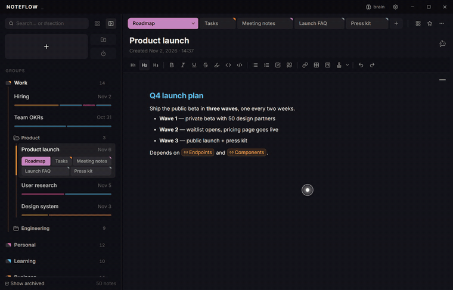

<div align="center">
  

  # NoteFlow

  **Fast notes for Windows, Linux & macOS developers.**
  *Local Markdown files, optional sync (private GitHub repo or encrypted NoteFlow Cloud). No telemetry. Just you and your thoughts.*

  [](https://github.com/yagoid/noteflow/releases/latest)
  [](LICENSE)

</div>

---

## What is NoteFlow?

NoteFlow is a keyboard-first, lightweight note-taking application for **Windows, Linux** (including Arch-based distributions like CachyOS) **and macOS** (Apple Silicon).

Built specifically for software engineers and power users who need something faster than Notion and less clunky than the built-in OS alternatives. Scratch down a task list, jot code snippets, or capture a quick thought — and optionally access all of it from a terminal or headless server.

## Features

- **Sections inside every note** — split a note into independent sections (each in markdown or plain-text mode), shown as a section map you can reorder, open side by side, or pop out into their own window. Hover a section to preview it.
- **Markdown-first editor** — headings (with a hover-to-expand table of contents), inline code, code blocks, tables, images, interactive task lists with deadlines, alarms and priority, and in-note kanban boards (stored as plain markdown). Type `/` for commands, links to other notes' sections and your snippets.
- **Snippets** — reusable text from a toolbar button or the `/` menu, with today's date/time in the format you pick (`{date:DD-MM-YYYY}`, `{time:HH:mm}`…).
- **Quick capture** — summon the app from anywhere with `Ctrl+Shift+Space`, or jot a temporary note (`Ctrl+Shift+N`) that cleans itself up after 24 h.
- **Floating sticky notes** — launch any note as an always-on-top window and switch between its sections from the title bar.
- **Groups & folders** — color-coded groups with sub-folders (each with its own icon), a sidebar that can stay pinned or float in on hover, a content view per group, templates, tags and a command palette (`Ctrl+P`).
- **The Brain (AI, optional)** — a local, offline semantic index that surfaces related notes, a 3D graph of your knowledge, and an AI chat that answers from your notes with citations. Bring your own provider (Anthropic, OpenAI, Ollama…) or use NoteFlow AI. Any section can be hidden from the AI.
- **Encrypted notes** — lock individual notes with a password; stored as ciphertext, no master key, no backdoor.
- **Sync, your way** — a private GitHub repo you control (Device Flow OAuth, no personal access tokens), or NoteFlow Cloud, an encrypted paid cloud with section-level merging across devices. Or no sync at all.
- **Headless CLI** — a zero-dependency Node.js companion CLI that reads/writes the same notes. Works over SSH, on Raspberry Pi, in cron jobs, and with AI agents.
- **14 themes, EN/ES interface** — dark and light themes (NoteFlow Dark, Tokyo Night, Dracula, Gruvbox, Arctic Day…), selectable fonts, and a built-in "What's new" tour.

## Download

Get the latest release from the [Releases page](https://github.com/yagoid/noteflow/releases/latest).

- **Windows**: `NoteFlow-X.Y.Z-Setup.exe` (recommended: includes the CLI and the open-at-login option)
  - Optionally, from the [Microsoft Store](https://apps.microsoft.com/detail/9NLP519T4X5F) (*NoteFlow - Quick Notes*): it installs without the SmartScreen warning and updates through the Store, but it **does not include the CLI** and **can't open by itself when Windows starts**.
- **macOS (Apple Silicon)**: `NoteFlow-X.Y.Z-arm64.dmg`
- **Debian/Ubuntu/Mint**: `noteflow_X.Y.Z_amd64.deb`
- **Arch/CachyOS/Manjaro**: use the AppImage below (the [`PKGBUILD`](PKGBUILD) is currently not working)
- **Universal Linux**: `NoteFlow-X.Y.Z.AppImage` (works on any distro)

### macOS Installation

Open `NoteFlow-X.Y.Z-arm64.dmg` and drag **NoteFlow** to your Applications folder.

This build is **not signed with an Apple Developer ID** (NoteFlow is a free, source-available project), so on first launch macOS Gatekeeper will say the app "cannot be opened because Apple cannot check it for malicious software." This is expected — to open it once:

- **Right-click** (or Control-click) the NoteFlow app → **Open** → **Open** in the dialog.

If that doesn't work, clear the quarantine flag from a terminal:

```bash
xattr -dr com.apple.quarantine /Applications/NoteFlow.app
```

> Apple Silicon only (M1 and newer). Intel Macs are not currently supported.

#### CLI on macOS (optional)

The companion `noteflow` CLI ships inside the app bundle. To put it on your `PATH`:

```bash
ln -sf /Applications/NoteFlow.app/Contents/Resources/cli/noteflow.js /usr/local/bin/noteflow
chmod +x /Applications/NoteFlow.app/Contents/Resources/cli/noteflow.js
```

### Arch/CachyOS Installation

Use the AppImage (it also updates itself in-app):
```bash
wget https://github.com/yagoid/noteflow/releases/latest/download/NoteFlow-2.2.0.AppImage
chmod +x NoteFlow-2.2.0.AppImage
./NoteFlow-2.2.0.AppImage
```

> The [`PKGBUILD`](PKGBUILD) in this repo is currently **not working** (the installed app is missing its `node_modules` and the native modules are not built for the system `electron`). Use the AppImage until it is fixed.

*[Landing page](https://yagoid.github.io/noteflow/) · [Features](https://yagoid.github.io/noteflow/features) · [AI](https://yagoid.github.io/noteflow/ai) · [CLI reference](https://yagoid.github.io/noteflow/cli)*

## CLI

A standalone CLI ships with every install and is also available for headless systems:

```bash
# Headless install (Linux / Raspberry Pi) — also installs the AI agent skill; re-run to update
curl -fsSL https://raw.githubusercontent.com/yagoid/noteflow/main/cli/install-cli.sh | sudo bash

# Usage
noteflow add "fix CORS bug" --tag urgent
noteflow list --group backend --json
noteflow push
```

Full reference → the [CLI page](https://yagoid.github.io/noteflow/cli) and `noteflow help <command>`. The agent guide lives in [`cli/noteflow-cli/SKILL.md`](cli/noteflow-cli/SKILL.md).

### AI Agent Skill

The NoteFlow skill lets your AI agent (Claude Code, Cursor, etc.) work with your notes from any conversation. The desktop app and the headless installer already place it in `~/.claude/skills` and `~/.agents/skills`; to install it by hand:

```bash
npx skills add yagoid/noteflow/cli/noteflow-cli
```

## Development

```bash
git clone https://github.com/yagoid/noteflow.git
cd noteflow
npm install
npm run dev
```

To build the installers:

```bash
npm run dist
# Generates for Windows: NoteFlow-X.Y.Z-Setup.exe
# Generates for Linux:
#   - noteflow_X.Y.Z_amd64.deb (Debian/Ubuntu/Mint)
#   - NoteFlow-X.Y.Z.AppImage (Universal Linux)
# Generates for macOS (only when run on an Apple Silicon Mac):
#   - NoteFlow-X.Y.Z-arm64.dmg
```

## License

[GNU General Public License v3.0 or later](LICENSE) (`GPL-3.0-or-later`).

NoteFlow is free software: you can use, study, share, and modify it freely. Any
distributed derivative work must also be released under the GPL-3.0 (or a later
version), keeping the source available under the same copyleft terms.
